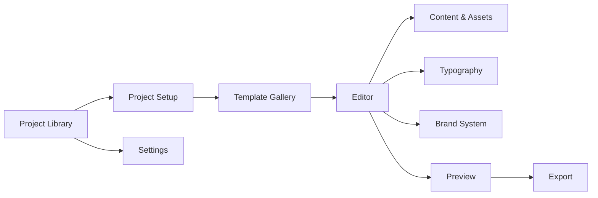
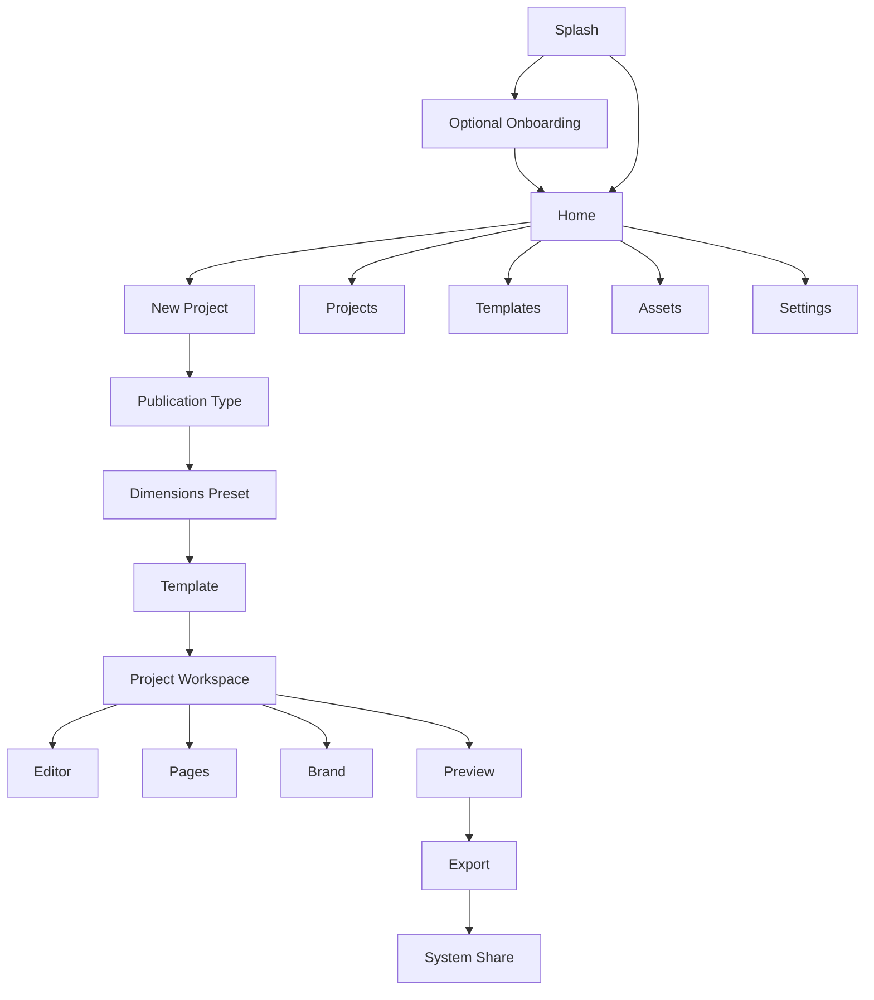
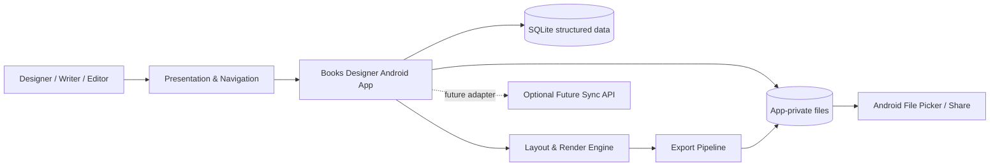
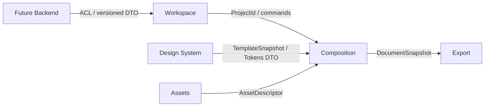
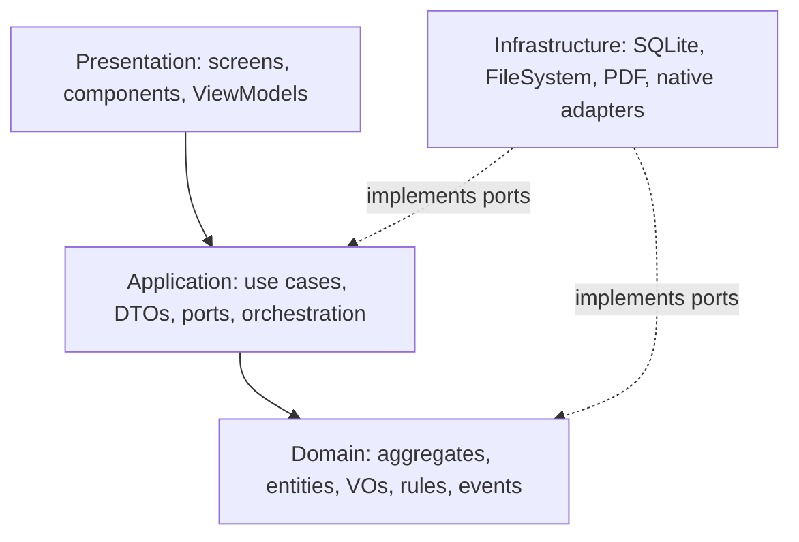
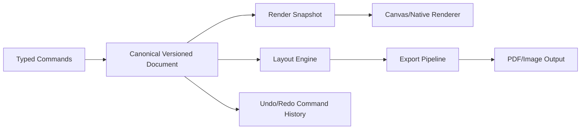

# تحليل معماري ومنتجي شامل — Books Designer

> **حالة الوثيقة:** تحليل وتوثيق تأسيسي، وليس تقرير تنفيذ أو اختبار. المستودع الحالي/README مادة بحثية تحريرية، وليس تطبيقاً برمجياً منفذاً بعد. لا تثبت هذه الوثيقة وجود شاشات أو كود أو قياسات أداء أو اختبارات ناجحة.
>
> **تاريخ الوثيقة:** 2026-11-03
>
> **النطاق:** Android-first، React Native، Expo SDK 54، TypeScript، تجربة محلية أولاً، ومحرر بصري للكتب والمجلات والمطبوعات.

## Executive Summary

Books Designer مقترح كتطبيق محلي أولاً يمكّن مصمماً مستقلاً أو كاتباً/محرراً صغيراً من تحويل محتوى منظم إلى منشور متسق بصرياً: مشروع، إعداد، قالب، تحرير صفحات مرئي، معاينة، ثم حفظ أو تصدير. القيمة في الإصدار الأول ليست محاكاة InDesign كاملة، بل تقليل العمل اليدوي المتكرر مع إبقاء القرار الإبداعي بيد المستخدم.

القرار المعماري الأساسي هو **Modular Monolith محلي** داخل تطبيق Expo، مبني بطبقات Clean Architecture وحدود Bounded Contexts واضحة. لا يُفرض Backend أو حساب أو مزامنة في MVP. يُفصل نموذج المستند canonical versioned عن Renderer وعن React، وتُحفظ البيانات المنظمة في SQLite عبر Repository، بينما تبقى الصور والخطوط وملفات التصدير في تخزين ملفات التطبيق مع manifest وchecksum. [1][2][3]

يستهدف الإصدار الأول Android وarm64-v8a، ويستخدم Expo SDK 54 المرتبط بـ React Native 0.81؛ تُفعّل New Architecture وتُختبر كل مكتبة Native على SDK 54 قبل اعتمادها. لا يُفترض أن Expo Go يكفي دائماً: يبقى مسار MVP متوافقاً معه إن أمكن، ويُستخدم Development Build فقط عندما تفرض مكتبة PDF أو Canvas أو معالجة صور ذلك. [1][4][5]

هذه الوثيقة تفصل أربعة أنواع من المعلومات:

- **حقائق مؤكدة:** مستخلصة من المواصفات والوثائق الخارجية، أو من نتائج المسارات المقدمة.
- **قرارات مقترحة:** خط أساس قابل للتنفيذ يحتاج اعتماداً قبل البناء.
- **افتراضات:** نقاط لم تحسمها المواصفات.
- **وظائف مؤجلة:** عناصر خارج MVP، لا يجوز الوعد بها في الإصدار الأول.

## Product Vision

### الرؤية

تمكين مصمم أو كاتب أو فريق تحرير صغير من إنتاج كتاب أو مجلة أو مطبوعة متعددة الصفحات على جهاز Android متوسط، من دون حاجة إلى اتصال أو حساب، عبر محرر بصري يربط القالب والهوية والمحتوى والتصدير في سير عمل واحد.

### الوعد الأساسي

> **من مشروع وقالب إلى منشور متسق قابل للمعاينة والتصدير، بأقل عمل يدوي متكرر، مع إبقاء المحتوى والقرار الإبداعي تحت سيطرة المستخدم.**

### ما لا يعد به MVP

لا يعد الإصدار الأول بمحرك تنضيد احترافي، أو توافق PDF/X، أو إدارة ألوان CMYK/ICC، أو تعاون سحابي، أو مشاركة تحريرية لحظية، أو مكتبة خطوط سحابية، أو ذكاء اصطناعي، أو محاكاة كاملة لبرامج النشر المكتبي.

### معايير نجاح المنتج

1. إتمام المسار: فتح التطبيق ← مشروع ← إعداد ← قالب ← محتوى ← تنسيق ← معاينة ← حفظ/تصدير.
2. عدم فقد المحتوى عند الحفظ أو الإغلاق القسري أو الاستعادة.
3. وضوح حالة الحفظ، والتراجع، والفشل، وموضع ملف التصدير.
4. عمل العناصر الأساسية بالعربية RTL والإنجليزية LTR في الوضعين الفاتح والداكن.
5. أداء مقبول على جهاز Android متوسط وفق قياسات فعلية لاحقة، لا وفق ادعاء مسبق.

## Product Feature Map



| الوحدة | نطاقها في MVP | الحد المقترح |
|---|---|---|
| Project Library | إنشاء، فتح، بحث/فرز أساسي، تكرار/حذف لاحقاً | مشاريع محلية فقط |
| Project Setup | النوع، Preset، الاتجاه، الهوامش، Bleed/Safe Area | مقاسات محددة مسبقاً؛ Custom متقدم مؤجل |
| Template Gallery | قوالب أولية قابلة للتخصيص | عدد محدود داخل التطبيق |
| Editor | صفحات وعناصر نص/صورة/شكل، تحديد، تحريك، تحجيم، طبقات، Undo/Redo | صفحة حالية مع تحميل كسول |
| Content & Assets | إدخال نصوص وصور وأشكال وأصول محلية | تخزين الملفات خارج DB |
| Typography | أنماط عنوان/متن/تعليق، RTL، وزن ومحاذاة | خطوط مضمّنة/محلية فقط |
| Brand System | ألوان، خطوط، أنماط، مسافات | تطبيق Token أو تعديل عنصر منفرد |
| Preview | تصفح الصفحات وفحص مبسط | ليس فحص طباعة احترافياً |
| Export | PDF أولي، تقدم، نجاح/فشل، مشاركة | محلي وforeground في MVP |
| Settings | اللغة، الاتجاه، الثيم، التفضيلات | العربية والإنجليزية، فاتح/داكن |

## Functional Requirements

### Must — الإصدار الأول

- إنشاء مشروع محلي وتسميته وفتحه واستعادته.
- اختيار نوع منشور ومقاس من قائمة Presets محدودة.
- تطبيق قالب أولي وتعديله.
- دعم مستند صفحة واحدة ومتعدد الصفحات بحدود معلنة.
- إضافة وتحرير نص وصورة وشكل.
- تحديد، تحريك، تحجيم، دوران، محاذاة، ترتيب طبقات، حذف.
- دعم أساسيات المجموعات، مع جعل multi-select/التجميع الكامل ضمن أولوية Should إذا أثبتت القياسات أنها كبيرة.
- RTL عربي وLTR إنجليزي، وأنماط نص وألوان أساسية.
- حفظ تلقائي محلي، استرجاع بعد الانقطاع، وUndo/Redo ظاهر.
- معاينة وتصدير PDF أساسي ومشاركة الملف.
- حالات loading، empty، editing، saving/autosaved، offline/local، error، success، unsaved changes.

### Should

تكرار صفحة/عنصر، بحث وفرز المشاريع، قوالب متعددة، Brand System قابل لإعادة الاستخدام، إدارة أصول أفضل، تحذيرات Safe Area/Bleed، ثيم داكن كامل، إنجليزية كاملة، سجل تصدير، وإشعارات تقدم محسنة.

### Could

تاريخ إصدارات، استيراد مستند، قص متقدم، شبكات ذكية، مكونات قابلة لإعادة الاستخدام، صور عالية الدقة بخيارات ضغط، وخصائص محاذاة موسعة.

### Won't في MVP

الحسابات، Backend، المزامنة، التعاون، التعليقات، المشاركة اللحظية، EPUB، PDF/X، Preflight احترافي، إدارة ألوان كاملة، مكتبة خطوط سحابية، الذكاء الاصطناعي، Plugin Marketplace، والرسوم المتجهة المتقدمة.

### قواعد قبول وظيفية

لكل use case مدخل typed DTO ومخرج typed DTO وحدود معاملة وأحداثه. لا يعد السيناريو ناجحاً إلا إذا اكتمل دون فقد محتوى، وأظهر حالة واضحة، وأتاح بديلاً مرئياً لأي إيماءة، وأمكن استعادته بعد خطأ قابل للاسترجاع.

## Non-Functional Requirements

| المجال | المتطلب | طريقة الإثبات المستقبلية |
|---|---|---|
| الأداء | فتح المشروع، ظهور الصفحة، pan/zoom، الحفظ والتصدير ضمن ميزانيات تقاس على جهاز متوسط | Release profiling على أجهزة فعلية |
| الاستجابة | عدم حجب JS thread بعمليات فك الصور أو التصدير أو hashing | قياس frame time وFPS؛ مرجع 16.67ms عند 60fps [6] |
| الذاكرة | تحميل الصفحة الحالية وthumbnails فقط، مع LRU وحدود cache | peak RSS/heap وOOM tests |
| الاستمرارية | atomic writes، recovery marker، migrations قابلة للاختبار | crash/recovery وmigration tests |
| التوافق | SDK 54، Android، arm64-v8a، API matrix معلنة | APK/AAB inspection وdevice matrix |
| الوصول | تباين، أحجام لمس، labels، بدائل للإيماءات، تقليل الحركة | Component/E2E وaccessibility audit |
| التوطين | عربي/إنجليزي، RTL/LTR، ثيم فاتح/داكن | مصفوفة locale/direction/theme |
| الأمان | تخزين خاص، فحص الملفات، عدم تسريب المحتوى إلى telemetry | security tests وreview |
| القابلية للصيانة | حدود وحدات، ports، ADRs، schema versioning | lint، dependency rules، review |

## UX Architecture

### مبادئ UX

- وجهات جذرية قليلة، وWorkspace داخلي واضح.
- إجراء رئيسي واحد لكل شاشة.
- الأدوات السياقية في Bottom Sheets على الهاتف بدلاً من شريط دائم مزدحم.
- اسم المشروع وحالة الحفظ والرجوع متاحة دائماً.
- لا حوارات متداخلة.
- Tap يحدد، drag يحرك، pinch/zoom يغير التكبير لا حجم العنصر، handles تغير الحجم، وlong-press يفتح سياقاً؛ لكل إيماءة حرجة بديل زر مرئي.
- Glassmorphism على أسطح محددة فقط، لا خلف نص طويل أو Canvas كامل.

### هوية بصرية مقترحة

شخصية تحريرية هندسية هادئة تربط النص بالشبكة والقص الطباعي. تصور الشعار: حرفان/مساران متعامدان يوحيان بطيّة صفحة وخط شبكة، مع Wordmark مستقل وأيقونة Android مبسطة. Palette أولية: Ink للنص، Paper للخلفية، Accent نحاسي/مرجاني، وأس surfaces شفافة منخفضة الشفافية. تُستخدم Design Tokens للون، التباين، المسافات، radius، elevation، والحالات.

هذه هوية اتجاهية تحتاج تحققاً بصرياً؛ ليست هوية معتمدة ولا نتيجة بحث مستخدمين.

## Application Navigation Map



Root destinations: Home، Projects، Templates، Assets، Settings، مع New Project كإجراء رئيسي. داخل المشروع: Overview، Editor، Pages، Brand، Preview، Export. تستخدم Expo Router typed file-based routes، وتمرر IDs فقط مثل `projectId` و`documentId` و`pageId`؛ لا تمرر كائنات مستند كبيرة أو حالة محرر في route params. [7]

## System Context Diagram



**حدود النظام:** في MVP لا يوجد خادم مطلوب. التخزين المنظم محلي، والملفات الثنائية خارج قاعدة البيانات. مشاركة التصدير تمر عبر واجهات النظام؛ بعد handoff لا يضمن التطبيق سرية النسخة التي يحتفظ بها التطبيق الآخر.

## DDD Analysis

### Bounded Contexts

1. **Workspace/Project Management:** ملكية المشروع، اسمه، إعداداته، حالته.
2. **Document Composition:** المستند، الصفحات، العناصر، الطبقات، القيود؛ النواة الأساسية.
3. **Design System & Templates:** القوالب، الشبكات، الأنماط، الألوان، الخطوط، الهوية.
4. **Assets & Media:** الملفات، metadata، checksum، URI، التحويلات.
5. **Export & Publishing:** الطلب، الحالة، الملف الناتج، سجل التصدير، الفحص.

Typography وImage Processing وPage Management قدرات داخل هذه السياقات في MVP، وليست Bounded Contexts مستقلة.

### Aggregates وValue Objects

- Project: `projectId`، الاسم، الإعدادات، الحالة؛ لا يضم كل الصفحات.
- Document: `documentId`، `projectId`، نوع المنشور، المقاس، الإصدار.
- Page: `pageId`، ترتيب الصفحة، الأبعاد، bleed، safe area؛ حد الاتساق لعناصره.
- Template: تعريف القالب وإصداره.
- BrandSystem: tokens وقواعد الهوية.
- Asset: metadata وchecksum ومرجع الملف لا البايتات.
- ExportJob: الطلب، الحالة، الوجهة، النتيجة.

العناصر Text/Image/Shape/Group كيانات داخل Page. Position، Size، Rotation، Color، FontSpec، PageSize، Margins، Bleed، SafeArea، SchemaVersion، AssetRef هي Value Objects immutable.

### Invariants

- أبعاد الصفحة موجبة.
- `z-order` فريد ضمن الصفحة أو تحكمه سياسة معلنة.
- لا تتكرر هوية العنصر.
- لا تحتوي المجموعة نفسها ولا تنشئ دورة.
- FontSpec صالح، وAssetRef موجود وchecksum متطابق.
- Document لا ينشر بلا صفحات صالحة.
- ExportJob لا ينتقل من Completed إلى Running.
- كل تغيير مستندي يزيد `revision/updatedAt` ويصدر Domain Event.

### قرار DDD — D-001: Page كحد اتساق

- **المشكلة:** جعل Document حاوياً لكل العناصر يضخم المعاملة والذاكرة.
- **الحل:** Document ينسق ترتيب الصفحات، وكل Page يملك عناصره كحد اتساق.
- **السبب:** تحميل/تفريغ الصفحات يلائم Android المتوسط ويعزل عمليات التحرير.
- **البدائل:** Document aggregate ضخم؛ أو كل عنصر aggregate مستقل.
- **الأثر:** أوامر الحركة/التحجيم تُنفذ على Page، وتحتاج عمليات النسخ إلى orchestration.
- **الاختبار:** property tests للترتيب والدورات، application tests لعمليات Page، وload tests لصفحات 10/50/100/250.
- **قابلية التغيير:** يمكن تقسيم Page لاحقاً إلى segments أو command batches دون تغيير API الواجهة.

### Context Map



لا مشاركة لكيانات ORM بين السياقات. القوالب تُطبق كـ snapshot ثابت داخل المستند، لا كمرجع حي قابل لتغيير الماضي.

## Clean Architecture Blueprint



- **Presentation:** التنقل، UI state، ViewModel/Presenter، لا SQLite أو FileSystem أو HTTP.
- **Application:** Commands/Queries، DTOs، orchestration، حدود المعاملات، mapping، ports.
- **Domain:** TypeScript خالصة؛ لا React Native أو Expo أو SQL أو HTTP.
- **Infrastructure:** adapters للتخزين والملفات وPDF والصور والشبكة والتسجيل.
- **Composition Root:** تركيب الاعتماديات في bootstrap.

### قرار D-002: Modular Monolith

- **المشكلة:** Backend أو microservices مبكرة ستزيد التعقيد قبل إثبات القيمة.
- **الحل:** تطبيق واحد بوحدات وحدود ports/adapters.
- **السبب:** MVP محلي وفردي، وحاجة المنتج الحالية أداء وتجربة لا توزيع خدمات.
- **البدائل:** Microservices؛ Backend إلزامي؛ طبقة UI مباشرة على DB.
- **الأثر:** بساطة نشر أعلى، مع ضرورة فرض حدود الاستيراد داخلياً.
- **الاختبار:** dependency lint، اختبارات ports، integration لكل adapter.
- **قابلية التغيير:** يمكن إضافة Sync Gateway خلف Port دون إدخال الشبكة إلى Domain.

## Frontend Architecture Blueprint

### ملكية الحالة

- **Global UI/session:** اللغة، الثيم، الاتصال، المشروع المفتوح، auth لاحقاً.
- **Editor feature state:** selection، tool، viewport، dirty/autosave، undo/redo.
- **Local component state:** dialogs، bottom sheets، حقول مؤقتة.
- **Persistent state:** repositories للـprojects/documents/preferences.
- **Derived state:** `canUndo`، `visiblePages`، validation؛ لا تُخزن.

تستخدم أوامر التحرير typed commands مع patch/inverse patch وcoalescing للحركات والكتابة. لا يصبح React state مصدر الحقيقة.

### التوطين والثيم

مصدر الترجمة typed keys بالعربية والإنجليزية، ومنع النصوص الصلبة داخل المكونات. direction وtheme preferences قابلة للاستمرار. تغيير RTL قد يتطلب إعادة تشغيل التطبيق وفق I18nManager، لذا لا ينبغي أن يفقد جلسة التحرير. [8]

### قرار D-003: IDs فقط في المسارات

- **المشكلة:** تمرير مستند كامل عبر navigation ينتج stale state وتسرب ذاكرة.
- **الحل:** تمرير `projectId/documentId/pageId` واسترجاع الحالة من feature store/repository.
- **السبب:** deep linking واختبار المسارات وعزل الشاشات.
- **البدائل:** تمرير كائنات كبيرة؛ جعل route مصدراً للحقيقة.
- **الأثر:** loaders ومراحل استرجاع داخل الشاشة.
- **الاختبار:** deep-link tests، استعادة بعد background، واختبار عدم تكرار snapshot.
- **قابلية التغيير:** يمكن إضافة workspace route جديد دون تغيير نموذج المستند.

## Backend Architecture Blueprint

### قرار MVP

لا Backend إلزامي. الميزات المحلية تشمل المشاريع، التحرير، القوالب المحلية، الأصول المحلية، الحفظ، المعاينة، والتصدير المحلي متى أمكن.

### حد مستقبلي

عند ثبوت الحاجة للمصادقة أو المزامنة أو التعاون أو المعالجة الخادمية، يُضاف نظام منفصل بعقد versioned API. يبقى التطبيق local-first عبر outbox و`revision/operationId`، ويستخدم ACL لتحويل DTOs الشبكة إلى أوامر محلية. لا تُشارك قاعدة بيانات العميل ولا كيانات Domain كـ API DTOs.

### قرار D-004: تأجيل Backend

- **المشكلة:** لا توجد حاجة مؤكدة للحساب أو التعاون الآن.
- **الحل:** ports مستقبلية بلا تنفيذ خدمة.
- **السبب:** تقليل مساحة الفشل وتسريع اختبار المسار الأساسي.
- **البدائل:** Backend من اليوم الأول؛ مزامنة ملف SQLite كاملاً.
- **الأثر:** لا وعود بمزامنة أو استعادة سحابية.
- **الاختبار:** اختبارات application ببديل in-memory، ثم contract tests عند إضافة API.
- **قابلية التغيير:** adapter جديد وSync Application Service مع سياسة تعارض معلنة.

## Database ER Design

```mermaid
erDiagram
  PROJECTS ||--o{ DOCUMENTS : contains
  DOCUMENTS ||--o{ PAGES : has
  PAGES ||--o{ ELEMENTS : owns
  PROJECTS ||--o{ ASSETS : owns
  PROJECTS ||--o{ BRAND_SYSTEMS : uses
  DOCUMENTS ||--o{ EXPORT_JOBS : exports
  EXPORT_JOBS }o--|| ASSETS : outputs
  DOCUMENTS ||--o{ DOCUMENT_REVISIONS : versions

  PROJECTS { string id PK; string name; string status; datetime createdAt; datetime updatedAt; int schemaVersion }
  DOCUMENTS { string id PK; string projectId FK; string kind; float width; float height; string unit; int schemaVersion; int revision; datetime updatedAt }
  PAGES { string id PK; string documentId FK; int ordinal; float width; float height; json background; int revision }
  ELEMENTS { string id PK; string pageId FK; string parentId; string type; int zIndex; float x; float y; float width; float height; float rotation; json payloadJson; json styleJson; int revision }
  ASSETS { string id PK; string projectId FK; string kind; string fileUri; string checksum; int byteSize; string mime; json metadataJson }
  BRAND_SYSTEMS { string id PK; string projectId FK; json tokensJson; json fontsJson; json colorProfilesJson }
  EXPORT_JOBS { string id PK; string documentId FK; string format; json optionsJson; string status; string outputAssetId; string error; datetime createdAt }
  DOCUMENT_REVISIONS { string id PK; string documentId FK; int revision; string snapshotUriOrJson; datetime createdAt }
```

التخزين المقترح SQLite عبر `expo-sqlite` للبيانات المنظمة، وFileSystem للصور والخطوط وPDF/thumbnails. لا تُخزن blobs الكبيرة داخل SQLite. تستخدم transactions قصيرة، prepared statements، WAL عند ملاءمته، وmigration runner يتحقق من `schemaVersion`. [2]

### قرار D-005: JSON polymorphic مع حقول علائقية

- **المشكلة:** جداول نوعية كثيرة ستزيد migrations المبكرة، بينما JSON كامل يصعّب الاستعلام.
- **الحل:** `elements` polymorphic؛ الحقول الحرجة علائقية، و`payloadJson/styleJson` versioned.
- **السبب:** توازن بين التطور والاستعلام.
- **البدائل:** جدول لكل نوع؛ مستند JSON واحد كامل.
- **الأثر:** يلزم حد لحجم payload وترحيله واختبارات round-trip.
- **الاختبار:** schema validation، migration tests، round-trip serialization، وفحص زمن التحديث.
- **قابلية التغيير:** split tables لاحقاً للحقول التي تثبت الحاجة إلى فهرستها.

## Document Engine Architecture



- Canonical JSON versioned هو مصدر الحقيقة.
- Document/Page/Element typed discriminated unions.
- Layout يحسب boxes وline breaks وconstraints؛ Renderer يستهلك snapshot.
- Renderer لا يكتب مباشرة إلى التخزين ولا يملك قواعد المجال.
- الحركات المتتابعة تُدمج زمنياً؛ لا تسجل الحالات المشتقة أو كل frame.
- التصدير: validate schema ← resolve assets/fonts ← layout ← render ← preflight مبسط ← ملف نهائي.
- لا يُعلن PDF/X أو CMYK/ICC أو shaping عربي احترافي قبل spike ومخرجات فعلية.

### قرار D-006: command bus وinverse operations

- **المشكلة:** snapshots كاملة لكل ضغطة تستهلك الذاكرة.
- **الحل:** أوامر typed مع inverse/patch، coalescing، وcheckpoints محدودة.
- **السبب:** Undo حتمي وأخف على جهاز متوسط.
- **البدائل:** نسخ المستند كاملاً؛ undo على مستوى React state.
- **الأثر:** تعقيد أعلى في تعريف الأوامر وترحيلها.
- **الاختبار:** add/edit/delete/group/reorder وundo/redo وkill/recovery.
- **قابلية التغيير:** يمكن استبدال سجل الأوامر بـ journal داخلي دون تغيير UI contract.

## Component Architecture

### طبقات مكون الواجهة

1. **App Shell:** Providers، Router، theme، localization، error boundary.
2. **Library:** ProjectCard، SearchBar، EmptyState، ProjectActions.
3. **Workspace:** WorkspaceHeader، SaveStatus، WorkspaceTabs.
4. **Editor:** CanvasViewport، SelectionOverlay، TransformHandles، LayerList، ToolBar، BottomSheet.
5. **Pages:** PageThumbnail، PageManager، PageActions.
6. **Design:** TemplateCard، TokenEditor، TypographySheet، ColorSheet.
7. **Assets:** AssetGrid، AssetPicker، AssetPreview.
8. **Export:** PreviewPager، PreflightSummary، ExportProgress، ShareAction.
9. **Cross-cutting:** Button، Sheet، Dialog، Toast، LoadingSkeleton، ErrorState، ConfirmDialog.

كل مكون له هدف واحد، states واضحة، وlabels قابلة للتوطين. لا تعتمد قابلية القبول على snapshots وحدها؛ تختبر السلوك.

## Dependency Direction Rules

القواعد الملزمة:

- `presentation → application → domain` فقط.
- `infrastructure` ينفذ ports التي تملكها application/domain؛ لا يفرض أنواع SDK على Domain.
- Domain لا يستورد React Native أو Expo أو SQLite أو HTTP أو FileSystem.
- Presentation لا يستورد Infrastructure مباشرة.
- لا يستورد module كيانات module آخر؛ تستخدم DTO/Snapshot/ports.
- Shared يقتصر على primitives والعقود العامة، وليس مستودعاً للكيانات.
- لا تمرر ORM models إلى الواجهة أو API.
- لا تجعل React state مصدر الحقيقة.
- Composition Root وحده يركب الاعتماديات.

يُفحص ذلك عبر TypeScript project references أو ESLint import boundaries، واختبار CI يمنع المخالفات.

## Proposed File Structure

```text
app/
  _layout.tsx
  (root)/
    index.tsx
    projects.tsx
    templates.tsx
    assets.tsx
    settings.tsx
  workspace/
    [projectId]/
      index.tsx
      editor/[documentId].tsx
      pages/[documentId].tsx
      brand/[projectId].tsx
      preview/[documentId].tsx
      export/[documentId].tsx
src/
  features/
    projects/{presentation,application,domain,infrastructure}/
    documents/{presentation,application,domain,infrastructure}/
    templates/{presentation,application,domain,infrastructure}/
    assets/{presentation,application,domain,infrastructure}/
    brand/{presentation,application,domain,infrastructure}/
    export/{presentation,application,domain,infrastructure}/
    settings/{presentation,application,domain,infrastructure}/
  shared/
    domain/
    application/
    ui/
    localization/
    design-tokens/
    test-utils/
  infrastructure/
    sqlite/
    filesystem/
    rendering/
    pdf/
    platform/
  bootstrap/
    composition-root.ts
    migrations.ts
    dependency-container.ts
  types/
  config/
assets/
  fonts/
  templates/
docs/
  architecture-analysis.md
  adr/
  product/
  runbooks/
tests/
  unit/
  integration/
  component/
  e2e/
  performance/
```

هذه بنية مقترحة فقط؛ لا تدعي أن الملفات موجودة حالياً.

## Technology Stack Evaluation

| الخيار | القرار | التقييم |
|---|---|---|
| React Native + Expo SDK 54 | اعتماد | يطابق المواصفة؛ يربط RN 0.81 وإصدارات حزم محددة [1][4] |
| TypeScript | اعتماد | نماذج typed وcommands وDTOs وschema |
| Expo Router | اعتماد | file-based routes، typed routes، deep links [7] |
| New Architecture | اعتماد مبدئي | SDK 54 يفعّلها للمشاريع الجديدة؛ يلزم اختبار المكتبات [3][4] |
| expo-sqlite | اعتماد مبدئي | persistence، transactions، prepared statements؛ يلزم قياس payload [2] |
| FileSystem app-private | اعتماد | يفصل الملفات الثنائية عن DB، ويقلل صلاحيات التخزين [9] |
| PDF/Canvas native library | قرار مؤجل بعد spike | التوافق مع SDK 54 وNew Architecture وExpo Go غير مثبت |
| SecureStore | للأسرار الصغيرة فقط | ليس مخزناً للمستندات أو الملفات الكبيرة [10] |
| Jest/jest-expo + RNTL | اعتماد للاختبارات | طبقات unit/component؛ لا تغني عن Android E2E [11][12] |
| EAS/GitHub Actions | مقترح | يتطلب حسابات وصلاحيات غير مفحوصة حالياً |

## Android Compatibility Strategy

- إنتاج AAB مع `arm64-v8a`، مع فحص آلي للـartifact؛ ABI مستقل عن API level. [5]
- SDK 54 وNew Architecture baseline؛ لا خلط لإصدارات Expo/RN خارج مصفوفة SDK.
- معالجة edge-to-edge وinsets من اليوم الأول؛ لا تسريب insets إلى Domain.
- مسار Expo Go للميزات المتوافقة فقط، وDevelopment Build عند الحاجة إلى Native module مخصص.
- مصفوفة أولية مقترحة: API 26/28 للتغطية العملية، وAPI 35/36 لمسارات Android الحديثة؛ الحد النهائي وRAM والأجهزة لم تحسم.
- لا طلب عام لـ`MANAGE_EXTERNAL_STORAGE` أو صلاحيات قديمة؛ استخدام app-private storage وsystem picker/SAF عند الحاجة. [9]
- thumbnails، virtualized lists، render-on-demand، FileHandle/streaming للملفات الكبيرة.
- لا قياس أداء على dev build فقط؛ القياس في release على جهاز متوسط.

### قرار D-007: Expo Go مع Development Build اختياري

- **المشكلة:** بعض محركات PDF/Canvas قد تحتاج Native modules، بينما المطلوب مسار Expo Go حيث أمكن.
- **الحل:** إبقاء MVP ضمن Expo modules المتوافقة؛ إنشاء Development Build عند سبب موثق.
- **السبب:** تقليل كلفة البناء الأصلي مع عدم حبس المعمارية.
- **البدائل:** رفض كل Native؛ أو prebuild/native من البداية.
- **الأثر:** مساران للاختبار والتوثيق.
- **الاختبار:** compatibility spike، Expo Doctor، Android build فعلي، وفحص ABI.
- **قابلية التغيير:** adapter يعزل المكتبة ويمكن تبديلها دون تغيير Domain.

## Testing Strategy

1. **Static:** TypeScript، ESLint، schema validation، import boundaries.
2. **Domain unit/property:** invariants، transforms، z-order، group cycles، RTL model، round-trip.
3. **Application:** use cases، in-memory repositories، events، transaction boundaries.
4. **Migration:** من كل schema مدعوم إلى الأحدث، مع نسخة احتياطية قبل migration.
5. **Integration:** SQLite، FileSystem، atomic write، checksum، crash recovery.
6. **Component:** سلوك selection، bottom sheets، save state، accessibility؛ لا snapshots وحدها.
7. **E2E Android:** إنشاء، تعديل، إغلاق قسري، استعادة، Preview، Export، Share، deep link.
8. **Golden/render:** تخطيط وتصدير مع tolerances للخطوط والمنصة.
9. **Performance:** مستندات 10/50/100/250 صفحة وصور كبيرة؛ قياس cold start، first page، FPS، peak RSS، save/export time، cache/database size.
10. **Security:** path traversal، MIME/signature، quotas، redacted logs، secrets scan.

لا توجد نتائج اختبار حالية؛ هذه خطة اختبار ومعايير قبول مقترحة فقط.

## GitHub Workflow

- `main` محمية، و`feature/*` عبر Pull Request؛ `release/*` عند الحاجة.
- فحوص إلزامية: lockfile، TypeScript، lint، unit/domain، schema، Expo Doctor، وdependency audit.
- CI سريع لكل PR؛ Android preview/AAB على push إلى main أو workflow_dispatch.
- فصل development/preview/production وruntimeVersion؛ EAS Update لتغييرات JS المتوافقة فقط.
- الأسرار في GitHub Secrets/OIDC أو EAS secrets؛ لا node_modules أو APKs غير لازمة أو مفاتيح توقيع في Git.
- commits صغيرة قابلة للتتبع، وADR عند قرارات الحدود أو المكتبات أو schema.
- نجاح CI لا يساوي توافق كل جهاز؛ يلزم Android release E2E.

## Security Strategy

- اعتبار المستندات والصور والخطوط وBrand data بيانات حساسة.
- فحص MIME الحقيقي، magic bytes/signature، الامتداد، الحجم، الأبعاد، ومعدل فك الضغط.
- quotas للصفحات والعناصر والنصوص والملفات؛ رفض المسارات المطلقة وpath traversal والروابط غير المصرح بها.
- تخزين app-private، وmanifest يضم URI وsize وMIME وSHA-256؛ كتابة مؤقتة ثم rename.
- SecureStore للأسرار الصغيرة وtokens فقط؛ لا مستندات أو blobs. [10]
- عدم إرسال نصوص أو صور إلى telemetry افتراضياً؛ redaction في logs/crash reports.
- عند تشفير ملفات حساسة مستقبلاً، استخدام مفتاح مناسب عبر Android Keystore، مع قرار استعادة واضح؛ لا يدعى تشفير شامل في MVP. [13]
- توضيح أن مشاركة الملف تسلم نسخة لتطبيق خارجي قد يحتفظ بها.
- dependency audit وlockfile وفحص أسرار في CI.

## Technical Documentation Structure

```text
docs/
  architecture-analysis.md
  adr/
    ADR-001-local-first.md
    ADR-002-page-aggregate.md
    ADR-003-document-schema.md
    ADR-004-renderer-separation.md
    ADR-005-export-scope.md
    ADR-006-expo-native-dependencies.md
  domain/
    bounded-contexts.md
    aggregates-and-invariants.md
    commands-and-events.md
  product/
    vision-and-scope.md
    ux-flows.md
    presets.md
  data/
    er-design.md
    migrations.md
    file-manifest.md
  engineering/
    testing-strategy.md
    performance-baseline.md
    security-model.md
    release-runbook.md
  operations/
    recovery.md
    troubleshooting.md
    support-matrix.md
```

توثق كل ADR المشكلة، القرار، السبب، البدائل، الأثر، الاختبار، وقابلية التغيير. تُوسم الوثائق بوضوح: `Proposed`، `Accepted`، `Superseded`، أو `Implemented`؛ لا تستخدم `Implemented` قبل وجود دليل.

## Implementation Roadmap

### المرحلة 0 — تثبيت القرارات والـspikes

- اعتماد أول ثلاثة أنواع ومقاسات Presets.
- تحديد الجمهور، حدود الصفحات والعناصر، Android API/RAM، ومتطلبات PDF.
- إنشاء prototype بصري صغير للهوية والـCanvas.
- spike لـ SQLite، FileSystem، PDF/Canvas، الخط العربي، New Architecture، وABI.
- إنتاج ADRs واعتمادها؛ لا كود إنتاجي قبل إغلاق قرارات المخاطر العالية.

### المرحلة 1 — Foundation

- تهيئة Expo SDK 54 وTypeScript وRouter.
- Design Tokens، localization، RTL/LTR، theme، app shell.
- Clean Architecture boundaries وComposition Root.
- SQLite schema أولي، migrations، File manifest، recovery marker.

### المرحلة 2 — Project/Template Path

- Project Library وNew Project وPresets.
- Template snapshot وتطبيقه.
- save status وautosave وempty/error states.

### المرحلة 3 — Document Engine MVP

- Page/Element model، canonical JSON، commands، undo/redo.
- Canvas للصفحة الحالية، selection، move/resize/rotate، layers.
- Text/Image/Shape، RTL الأساسي، thumbnails وvirtualization.

### المرحلة 4 — Brand/Preview/Export

- Brand tokens، Typography/Color sheets.
- Preview وSafe Area/Bleed warnings المبسطة.
- Export PDF foreground، progress، failure recovery، share.

### المرحلة 5 — Quality Gate

- Domain/application/integration/component/E2E/performance/security tests.
- Android matrix وAAB arm64 inspection.
- قياسات release على الأجهزة المرجعية.
- UX prototype test قبل تثبيت التفاصيل.

### المرحلة 6 — Post-MVP

- بحث وفرز متقدم، version history، import، advanced crop، smart grids.
- دراسة الحساب/backup/sync فقط بعد دليل استخدامي، مع سياسة تعارض وتشفير.

## Risks & Mitigation Plan

| الخطر | الأثر | التخفيف | إشارة الخروج |
|---|---|---|---|
| تضخم نطاق المحرر | تأخر MVP وفقدان التركيز | قفل Presets والعناصر والمسار الأساسي | كل Must يعمل دون ميزات سطح مكتب |
| OOM/jank مع صفحات وصور كبيرة | انهيار أو تجربة سيئة | lazy loading، thumbnails، LRU، streaming، حدود حجم | load/performance tests ناجحة على الجهاز المرجعي |
| عدم توافق Native مع SDK 54/New Architecture | توقف البناء أو فقد Expo Go | compatibility spike، adapter، Development Build مبرر | build Android وE2E يمران |
| edge-to-edge وRTL | قص وتراكب وأخطاء إحداثيات | insets في Presentation، مصفوفة RTL/theme | E2E على API 35/36 وعربي |
| خلط Preview بالطباعة | توقعات تجارية خاطئة | تسمية PDF أولي، preflight محدود، وثائق صريحة | قبول منتج لمواصفات PDF واضح |
| فقدان البيانات أثناء الحفظ/migration | فقد ثقة المستخدم | atomic writes، journal، backup، recovery tests | kill/recovery وmigration tests |
| أخطاء Arabic shaping/fonts | نص غير صحيح أو تصدير مختلف | spike محرك التنضيد، fonts licensed، golden tests | مخرجات عربية معتمدة |
| تسريب الملفات أو الأسرار | خطر خصوصية | app-private، SecureStore للأسرار، redaction، quotas | security review بلا findings حرجة |
| غياب بيانات المستخدم | ترتيب UX غير مؤكد | prototype usability test قبل التجميد | نتائج اختبار موثقة |
| إضافة Backend مبكراً | تعقيد وتعارضات | تأجيله وACL/ports فقط | قرار منتج مستقل وحاجة مثبتة |
| Android 32-bit/ABI | فقد شرائح من الجمهور أو فشل Play | حسم الجمهور وفحص AAB | دعم ABI موثق ومختبر |
| background export غير موثوق | ملفات ناقصة أو jobs معلقة | foreground MVP، استئناف واضح | قرار WorkManager/Native لاحقاً |

## Architecture Decision Records

### ADR-001 — Local-first MVP

- **الحالة:** مقترح.
- **المشكلة:** الحساب والسحابة يوسعان النطاق قبل إثبات المحرر.
- **القرار:** إنشاء وتحرير وحفظ وتصدير محلياً؛ ports مستقبلية للمزامنة.
- **السبب:** المسار الأساسي لا يحتاج خادماً، ويحسن الخصوصية والعمل دون اتصال.
- **البدائل:** Backend من البداية، أو ملف سحابي كمصدر حقيقة.
- **الأثر:** لا مزامنة أو تعاون في MVP؛ يلزم recovery محلي.
- **الاختبار:** فتح/تعديل/حفظ/kill/recovery دون اتصال.
- **قابلية التغيير:** Sync adapter وoutbox لاحقاً.

### ADR-002 — Document Data Model منفصل عن Renderer

- **المشكلة:** ربط القواعد بمكونات React يجعل التصدير والاختبار والترحيل هشاً.
- **القرار:** canonical versioned model؛ Renderer مستهلك snapshot.
- **السبب:** اختبار Domain بلا Native وإتاحة export مستقل.
- **البدائل:** React state كمصدر حقيقة، أو Canvas كقاعدة المجال.
- **الأثر:** mapping وselectors إضافية.
- **الاختبار:** round-trip، domain unit، golden render.
- **قابلية التغيير:** تبديل Canvas/PDF خلف adapter.

### ADR-003 — Schema Versioning وMigration

- **المشكلة:** المستندات المحلية تعيش أطول من إصدار التطبيق.
- **القرار:** `schemaVersion` في كل Document/ملف، migration runner ونسخة احتياطية قبل الترقية.
- **السبب:** استرجاع مستندات قديمة وتقليل فقد البيانات.
- **البدائل:** حذف البيانات القديمة، أو ترحيل يدوي.
- **الأثر:** تكلفة اختبارات واحتفاظ بنسخ.
- **الاختبار:** migration من كل إصدار مدعوم، round-trip، فشل آمن.
- **قابلية التغيير:** migrations متسلسلة وقرار سياسة downgrade لاحقاً.

### ADR-004 — SQLite للمنظم وFileSystem للثنائي

- **المشكلة:** blobs الكبيرة داخل DB ترفع الحجم والذاكرة ومخاطر التلف.
- **القرار:** SQLite metadata/snapshots، وapp-private files للصور والخطوط/التصديرات مع checksum.
- **السبب:** فصل دورة حياة البيانات وقابلية التنظيف.
- **البدائل:** DB blobs، أو ملفات عامة فقط.
- **الأثر:** manifest وعمليات atomic file لازمة.
- **الاختبار:** checksum، فقد ملف، cleanup، crash أثناء rename.
- **قابلية التغيير:** adapter لتخزين مختلف أو cloud assets لاحقاً.

### ADR-005 — Page Aggregate

- **المشكلة:** Document aggregate الضخم لا يلائم جهازاً متوسطاً.
- **القرار:** Page حد اتساق للعناصر؛ Document يملك الترتيب والمرجع.
- **السبب:** تحميل كسول وتحرير محلي.
- **البدائل:** aggregate واحد أو عنصر مستقل لكل عملية.
- **الأثر:** orchestration للنسخ وإعادة ترتيب الصفحات.
- **الاختبار:** invariants وload/performance.
- **قابلية التغيير:** segments أو batch commands.

### ADR-006 — Expo SDK 54 وNew Architecture

- **المشكلة:** خلط إصدارات أو مكتبات Native غير متوافقة يهدد البناء.
- **القرار:** تثبيت SDK 54، New Architecture baseline، `expo install` وExpo Doctor، Development Build عند الضرورة.
- **السبب:** توافق مصفوفة SDK الرسمية وتقليل native drift. [1][3][4]
- **البدائل:** Legacy architecture دائم، أو bare React Native.
- **الأثر:** فحص مبكر لكل dependency ومساران للاختبار.
- **الاختبار:** build Android، Expo Doctor، native module spike، AAB inspection.
- **قابلية التغيير:** ترقية SDK فقط عبر ADR واختبار ترحيل.

### ADR-007 — PDF أولي لا PDF/X

- **المشكلة:** مواصفات الطباعة الاحترافية لم تحسم، ومحرك PDF غير مختار.
- **القرار:** PDF للمشاركة/المعاينة مع تسمية صريحة؛ لا ادعاء PDF/X أو CMYK/ICC.
- **السبب:** منع توقع تجاري خاطئ.
- **البدائل:** التزام مبكر بـPDF/X؛ تأجيل كل التصدير.
- **الأثر:** قد يحتاج المستخدم workflow خارجياً للطباعة.
- **الاختبار:** فتح الملف، round-trip بصري، فحص مبسط، حجم وذاكرة.
- **قابلية التغيير:** إضافة Preflight ومحرك متخصص بعد spike واعتماد متطلبات.

### ADR-008 — Command Bus للـUndo/Redo

- **المشكلة:** snapshots كاملة لكل حركة مكلفة.
- **القرار:** typed commands وinverse patches وcoalescing وcheckpoints.
- **السبب:** ذاكرة أقل وحتمية أعلى.
- **البدائل:** full snapshots أو UI history.
- **الأثر:** تعريف واضح للأوامر وترحيلها.
- **الاختبار:** deterministic undo/redo، grouping، reorder، kill/recovery.
- **قابلية التغيير:** journal أو history backend لاحقاً.

### ADR-009 — Backend مؤجل وACL مستقبلي

- **المشكلة:** التعاون والمزامنة يفرضان تعارضات وهوية وخصوصية غير محسومة.
- **القرار:** لا Backend في MVP؛ API مستقبلي versioned خلف ports وACL، مع outbox عند الحاجة.
- **السبب:** الحفاظ على استقلال المجال المحلي.
- **البدائل:** last-write-wins مبكر، أو إرسال SQLite.
- **الأثر:** لا مزامنة بين الأجهزة حالياً.
- **الاختبار:** contract tests وconflict tests عند بدء المسار.
- **قابلية التغيير:** إضافة Sync Application Service وسياسة merge معلنة.

## Open Questions and Assumptions

### أسئلة غير محسومة

1. ما أول ثلاثة أنواع منشورات ومقاسات رسمية في MVP؟
2. هل الجمهور مصمم محترف أم مستخدم غير متخصص؟
3. هل PDF للمشاركة الرقمية أم للطباعة، وما متطلبات bleed/ICC/PDF/X؟
4. ما الخط العربي واللاتيني المرخصان؟ وهل يجب تضمين الخطوط؟
5. ما الحد الأقصى للصفحات والعناصر والصور على الجهاز المرجعي؟
6. ما الحد الأدنى النهائي لـAndroid وRAM ومساحة التخزين؟
7. هل يقبل المنتج Development Build عند الحاجة؟
8. هل القالب snapshot ثابت أم مرجع حي؟
9. هل توجد حاجة مؤكدة للحساب والنسخ الاحتياطي والمزامنة؟
10. هل remote GitHub وحسابات EAS وSecrets متاحة؟

### الافتراضات الحالية

- المستخدم الأساسي فرد أو فريق صغير، وليس تعاوناً لحظياً.
- MVP يعمل دون اتصال ويخزن البيانات محلياً.
- الملفات الثنائية خارج قاعدة البيانات.
- Presets تكفي البداية، وCustom sizing المتقدم مؤجل.
- الهوية المقترحة اتجاه تصميم يحتاج تحققاً بصرياً.
- New Architecture مفعلة مبدئياً، مع Development Build عند الحاجة.
- الأولوية UX/الهوية والنواة التحريرية، لا محرك طباعة كامل.

## References

[1] [Expo SDK 54 Documentation](https://docs.expo.dev/versions/v54.0.0/)

[2] [Expo SQLite — SDK 54](https://docs.expo.dev/versions/v54.0.0/sdk/sqlite/)

[3] [Expo New Architecture Guide](https://docs.expo.dev/guides/new-architecture/)

[4] [Expo SDK 54 Changelog](https://expo.dev/changelog/sdk-54)

[5] [Android 64-bit Requirements and ABIs](https://developer.android.com/google/play/requirements/64-bit)

[6] [React Native Performance Overview](https://reactnative.dev/docs/performance)

[7] [Expo Router Introduction](https://docs.expo.dev/router/introduction/)

[8] [React Native I18nManager](https://reactnative.dev/docs/i18nmanager)

[9] [Android Data Storage and Sensitive Data Guidance](https://developer.android.com/training/data-storage)

[10] [Expo SecureStore — SDK 54](https://docs.expo.dev/versions/v54.0.0/sdk/securestore/)

[11] [Expo Unit Testing Guide](https://docs.expo.dev/develop/unit-testing/)

[12] [React Native Testing Overview](https://reactnative.dev/docs/testing-overview)

[13] [Android Keystore System](https://developer.android.com/privacy-and-security/keystore)

[14] [Android Sensitive Data in External Storage](https://developer.android.com/privacy-and-security/risks/sensitive-data-external-storage)

[15] [GitHub Actions Documentation](https://docs.github.com/actions)

[16] [React Native Architecture Overview](https://reactnative.dev/architecture/overview)
